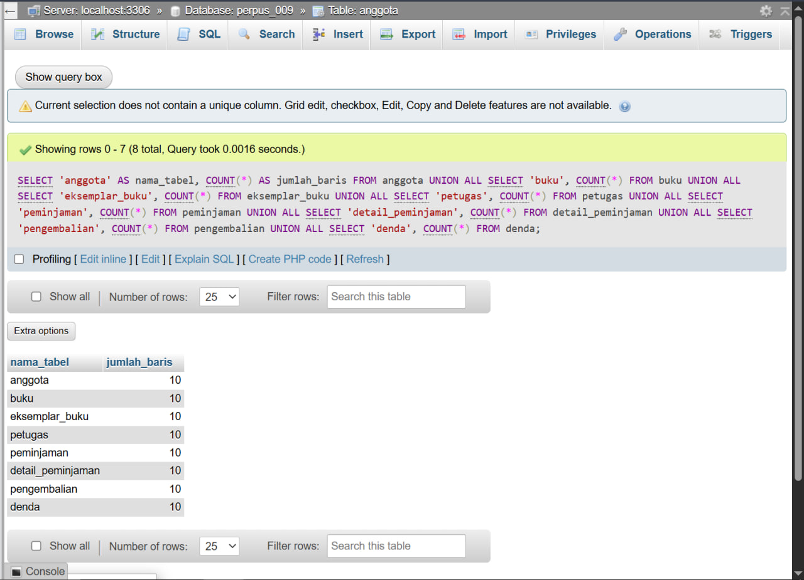
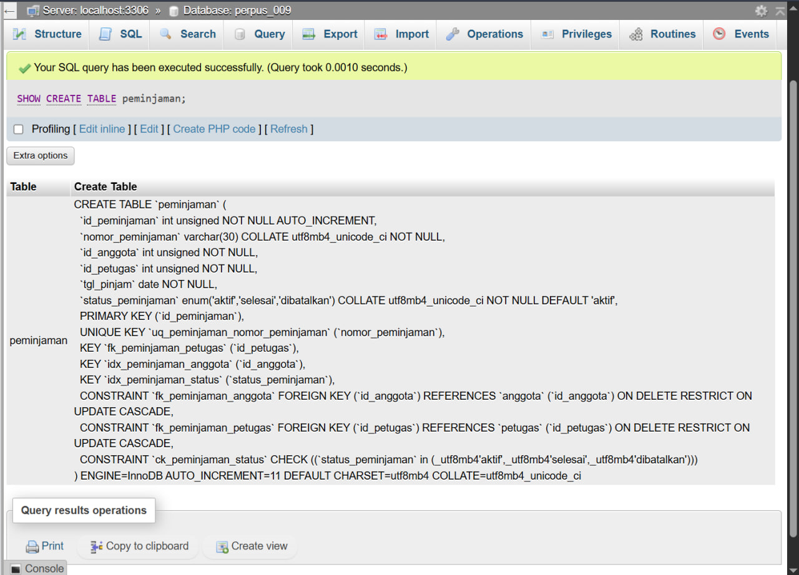
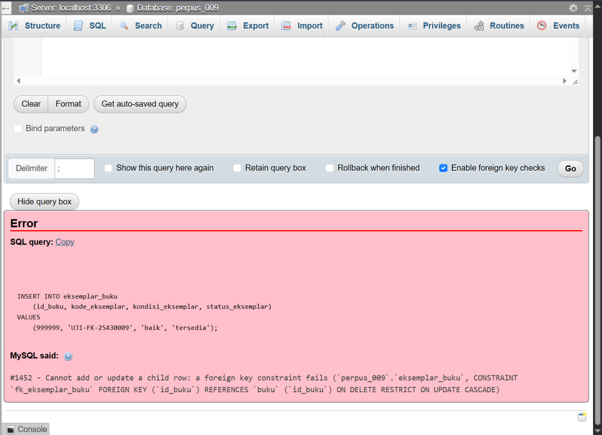
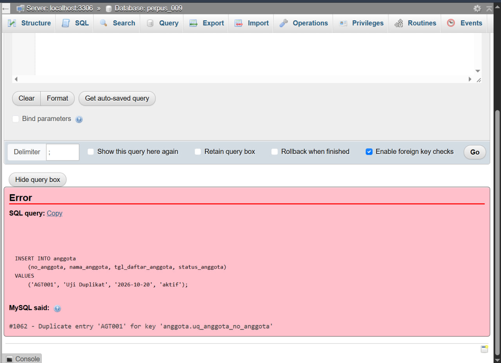
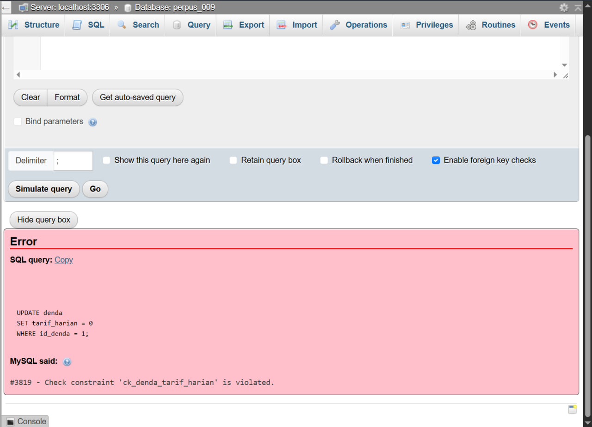

# Laporan Praktikum Basis Data — Pertemuan 5

**Nama:** Abbiyu Hashfi Dzakwan  
**NPM:** 25430009  
**Kelas:** A  
**Tema proyek:** Sistem Informasi Perpustakaan AHD  
**Database:** `perpus_009`  
**Parameter:** `P = 1` sehingga batas item peminjaman adalah `P + 2 = 3`  
**Tarif denda awal:** Rp1.000 per hari per buku  

## 1. Tujuan Praktikum

Pertemuan 5 bertujuan mengimplementasikan rancangan hasil normalisasi ke struktur basis data fisik menggunakan DDL (*Data Definition Language*). Kegiatan meliputi pembuatan tabel, pemilihan tipe data, penetapan primary key dan foreign key, penambahan constraint, serta pengujian bahwa constraint menolak data yang melanggar aturan.

## 2. Berkas yang Disiapkan

- `p05_ddl_25430009.sql` — skrip DDL dan pemeriksaan jumlah baris setelah eksekusi.
- `Laporan/p05_laporan_25430009.md` — laporan ini.
- `p05_erd_fisik_25430009.drawio` — sumber ERD fisik yang dapat diedit dan diselaraskan dengan struktur implementasi.
- `Screenshots/p05_erd_fisik_25430009.png` — ekspor gambar ERD fisik yang ditampilkan pada bagian 4.1.

## 3. Pemeriksaan Basis Data Sebelum Perubahan

Berkas `perpus_009(1).sql` yang diekspor dari phpMyAdmin diperiksa sebelum menyusun DDL. Dalam dump tersebut ditemukan delapan tabel data, masing-masing berisi 10 baris pada saat ekspor, sehingga totalnya 80 baris data pada tabel dasar.

| Tabel | Baris pada dump ekspor |
|---|---:|
| `anggota` | 10 |
| `buku` | 10 |
| `eksemplar_buku` | 10 |
| `petugas` | 10 |
| `peminjaman` | 10 |
| `detail_peminjaman` | 10 |
| `pengembalian` | 10 |
| `denda` | 10 |
| **Total tabel dasar** | **80** |

Dump juga memuat trigger untuk validasi proses peminjaman, perubahan status eksemplar, dan perhitungan denda, serta dua view laporan. Skrip DDL baru menggunakan `CREATE TABLE IF NOT EXISTS`, `CREATE TRIGGER IF NOT EXISTS`, migrasi kolom bersyarat, dan pemeriksaan keberadaan indeks/constraint; skrip tidak menggunakan `DROP TABLE`, `TRUNCATE`, atau `DELETE`.

### 3.1 Penyesuaian yang menjaga data lama

Struktur pada ekspor belum memiliki kolom `buku.kode_buku` dan `peminjaman.nomor_peminjaman` yang disebut dalam dokumen normalisasi dan kebutuhan data. DDL menambahkan kedua kolom itu hanya jika belum ada, kemudian mengisi kolom baru dengan identitas yang diturunkan dari data yang sudah tersedia:

- `kode_buku`: contoh pola `BUK-001`, berdasarkan `id_buku`.
- `nomor_peminjaman`: contoh pola `PJM-20260901-00001`, berdasarkan `tgl_pinjam` dan `id_peminjaman`.

DDL juga menambahkan `tarif_harian` dengan nilai awal `1000` bila kolom tersebut belum ada, serta menambahkan constraint yang belum tersedia. Implementasi kolom generated `id_eksemplar_aktif` ditiadakan pada versi akhir setelah penambahan kolom tersebut memunculkan error MySQL `#1215`. Validasi peminjaman eksemplar tetap mengandalkan trigger validasi dan pengelolaan status eksemplar. Nilai kolom lama—termasuk `jumlah_denda`—dipertahankan agar riwayat transaksi tidak hilang. Dengan demikian, `jumlah_denda` masih ada untuk kompatibilitas data historis, walaupun rancangan normalisasi mengidentifikasi total denda sebagai nilai turunan yang dapat dihitung dari hari keterlambatan dan tarif harian.

Pelebaran `petugas.kode_petugas` menjadi `VARCHAR(20)` tidak mengubah nilai kode yang sudah ada, tetapi mendukung format kode yang lebih panjang di kamus data.

**Catatan:** hitungan 80 baris di atas berasal dari dump sebelum skrip diterapkan. Gunakan screenshot hasil implementasi dan hasil hitung pada phpMyAdmin untuk mencocokkan jumlah baris aktual setelah DDL dijalankan. Screenshot saja tidak menggantikan pemeriksaan struktur dan data jika hasilnya belum terbaca jelas.

## 4. Rancangan Tabel dan Relasi

| Tabel | Fungsi | Kunci/aturan penting |
|---|---|---|
| `anggota` | Data identitas dan status anggota | PK `id_anggota`; UNIQUE `no_anggota` (AB-01) |
| `petugas` | Data petugas perpustakaan | PK `id_petugas`; UNIQUE `kode_petugas` |
| `buku` | Data judul/katalog buku | PK `id_buku`; UNIQUE `kode_buku`; UNIQUE ISBN bila diisi (AB-08) |
| `eksemplar_buku` | Unit fisik dari judul buku | PK `id_eksemplar`; FK `id_buku`; UNIQUE `kode_eksemplar` (AB-05, AB-08) |
| `peminjaman` | Kepala transaksi peminjaman | PK `id_peminjaman`; UNIQUE `nomor_peminjaman` (AB-03); FK anggota dan petugas |
| `detail_peminjaman` | Item buku pada transaksi | PK komposit `(id_peminjaman, id_eksemplar)`; FK transaksi dan eksemplar; validasi peminjaman aktif melalui trigger (AB-05) |
| `pengembalian` | Catatan pengembalian tiap item | PK `id_pengembalian`; UNIQUE `(id_peminjaman, id_eksemplar)`; FK ke detail dan petugas (AB-09) |
| `denda` | Catatan denda dan status pembayaran | PK `id_denda`; UNIQUE `id_pengembalian`; FK ke pengembalian; tarif harian awal Rp1.000 (AB-07, AB-10) |

### 4.1 Tampilan ERD fisik Pertemuan 5

Berikut adalah pratinjau ERD fisik terbaru yang disimpan sebagai `p05_erd_fisik_25430009.png`. Sumber diagram tetap tersedia dalam format Draw.io pada `p05_erd_fisik_25430009.drawio` agar bisa dibuka dan diedit kembali. Gambar ini dimaksudkan untuk menunjukkan struktur tabel serta hubungan PK/FK hasil implementasi Pertemuan 5.


*Gambar 1. ERD fisik Perpustakaan AHD berdasarkan implementasi Pertemuan 5.*

## 5. Alasan Pemilihan Tipe Data

| Tipe data | Pemakaian | Alasan |
|---|---|---|
| `INT UNSIGNED AUTO_INCREMENT` | Kunci pengganti tabel utama | Angka nonnegatif dan mudah digunakan sebagai PK/FK. |
| `VARCHAR` | Nomor/kode, nama, judul, ISBN, nomor HP | Panjang data bervariasi; kode dan nomor HP diperlakukan sebagai teks agar nol awal tidak hilang. |
| `TEXT` | Alamat anggota | Alamat dapat lebih panjang dibandingkan nama/kode. |
| `DATE` | Tanggal daftar, pinjam, jatuh tempo, kembali, dan pembayaran | Mendukung perbandingan tanggal dan perhitungan selisih hari. |
| `YEAR` | Tahun terbit buku | Menyimpan tahun terbit sebagai informasi tahun. |
| `ENUM` | Status transaksi, status eksemplar, kondisi, pembayaran | Membatasi nilai pada domain yang digunakan aplikasi perpustakaan. |
| `DECIMAL(12,2)` | Nilai denda yang sudah tercatat | Nilai nominal tidak menggunakan bilangan pecahan biner seperti `FLOAT`; kolom lama tetap dipertahankan agar data historis tidak hilang. |
| `INT UNSIGNED` | `tarif_harian` | Tarif harian berupa bilangan rupiah bulat nonnegatif. |
| Trigger | `trg_detail_peminjaman_validasi` dan trigger status eksemplar | Memeriksa status transaksi, ketersediaan eksemplar, dan batas maksimal tiga item pada saat penambahan detail. |

## 6. Constraint dan Pemetaan Aturan Bisnis

| Aturan bisnis | Implementasi | Catatan |
|---|---|---|
| AB-01 nomor anggota unik | UNIQUE `uq_anggota_no_anggota` | Dapat diuji dengan nomor anggota duplikat. |
| AB-02 hanya anggota aktif yang meminjam | Trigger `trg_peminjaman_anggota_aktif` dan FK | Trigger menolak peminjaman jika anggota tidak aktif/tidak ditemukan. |
| AB-03 nomor peminjaman unik | UNIQUE `uq_peminjaman_nomor_peminjaman` | Nomor pada transaksi lama dibentuk dari tanggal dan ID yang sudah ada. |
| AB-04 maksimal 3 item per transaksi | Trigger `trg_detail_peminjaman_validasi` pada dump saat ini | Batas jumlah baris tidak dapat ditegakkan oleh `CHECK` satu baris saja; modul juga meminta batas lintas-baris dianalisis untuk penanganan lanjutan. |
| AB-05 satu eksemplar tidak dipinjam dua kali bersamaan | Trigger `trg_detail_peminjaman_validasi` dan status eksemplar | Skrip hasil koreksi tidak memakai generated column/UNIQUE tambahan karena penambahan kolom sebelumnya memicu error `#1215`; validasi tetap menggunakan trigger yang sudah ada pada database ekspor. Uji perilaku ini perlu dilakukan sesudah DDL berjalan. |
| AB-06 tanggal jatuh tempo | `tgl_jatuh_tempo DATE NOT NULL` | Perbandingan dengan tanggal pinjam memerlukan pemeriksaan lintas tabel/proses. |
| AB-07 tarif denda Rp1.000 per hari per buku | `tarif_harian` dengan default `1000`; trigger perhitungan pada instalasi baru | Trigger pada database yang sudah ada tidak ditimpa; trigger ekspor lama sudah menghitung menggunakan tarif Rp1.000. |
| AB-08 satu judul bisa memiliki banyak eksemplar | FK `eksemplar_buku.id_buku` → `buku.id_buku` | Data judul dipisahkan dari unit fisiknya. |
| AB-09 pengembalian harus mengacu pada detail peminjaman | FK komposit dari `pengembalian` ke `detail_peminjaman` | Mencegah pengembalian atas item yang tidak tercatat pada transaksi. |
| AB-10 total denda terkait keterlambatan dan tarif | CHECK nilai denda tidak negatif; trigger menghitung jumlah saat insert | Nilai `jumlah_denda` yang sudah ada tetap dipertahankan untuk menjaga data lama. |

Nama constraint menggunakan pola `pk_`, `fk_`, `uq_`, atau `ck_` sesuai arahan modul. Skrip menamai ulang beberapa indeks UNIQUE yang sebelumnya memakai nama kolom/table default bila nama target belum digunakan. Penamaan indeks tidak menghapus baris data.

## 7. Prosedur Pelaksanaan di phpMyAdmin

1. Database yang digunakan adalah `perpus_009`; dump ekspor `perpus_009(1).sql` disimpan sebagai cadangan.
2. File `p05_ddl_25430009.sql` versi terbaru dilaporkan berhasil diimpor melalui phpMyAdmin.
3. Jumlah baris pada tabel diperiksa setelah implementasi. Gunakan angka yang ditampilkan phpMyAdmin sebagai hasil aktual; jumlah 80 baris pada bagian 3 adalah kondisi pada saat dump awal dibuat.
4. Struktur tabel utama diperiksa dengan `SHOW CREATE TABLE`, terutama PK, FK, UNIQUE, CHECK, dan tipe data kolom.
5. Pengujian negatif untuk FK, UNIQUE, dan CHECK dijalankan secara terpisah. Error yang diharapkan merupakan bukti constraint menolak data yang tidak valid, bukan tanda bahwa pengujian gagal.

### 7.1 Bukti hasil implementasi



*Gambar 1. Bukti hasil implementasi SQL di phpMyAdmin. Jumlah baris yang dilaporkan harus mengacu pada nilai yang benar-benar terlihat pada gambar.*

### 8 Struktur tabel utama

Pemeriksaan struktur dilakukan dengan `SHOW CREATE TABLE` untuk melihat kolom, primary key, foreign key, indeks UNIQUE, dan constraint lain yang terpasang.



*Gambar 2. Bukti pemeriksaan struktur tabel di phpMyAdmin.*

### 8.1 Pengujian Foreign Key (FK)

Pengujian menggunakan percobaan penambahan eksemplar dengan `id_buku` yang tidak tersedia pada tabel `buku`. Hasil yang diharapkan adalah MySQL menolak perintah karena referensi induk tidak ditemukan.

Contoh perintah pengujian:

```sql
INSERT INTO eksemplar_buku
    (id_buku, kode_eksemplar, kondisi_eksemplar, status_eksemplar)
VALUES
    (999999, 'UJI-FK-25430009', 'baik', 'tersedia');
```



*Gambar 3. Bukti pengujian foreign key. Pesan penolakan MySQL pada screenshot menjadi hasil aktual pengujian.*

### 8.2 Pengujian UNIQUE

Pengujian mencoba memasukkan nomor anggota yang sudah digunakan, yaitu `AGT001`. Hasil yang diharapkan adalah MySQL menolak duplikasi berdasarkan constraint UNIQUE pada `no_anggota`.

Contoh perintah pengujian:

```sql
INSERT INTO anggota
    (no_anggota, nama_anggota, tgl_daftar_anggota, status_anggota)
VALUES
    ('AGT001', 'Uji Duplikat', '2026-10-20', 'aktif');
```



*Gambar 4. Bukti pengujian UNIQUE. Pesan duplicate key pada screenshot menjadi hasil aktual pengujian.*

### 8.3 Pengujian CHECK

Pengujian mencoba memberikan nilai `0` pada `tarif_harian`, sedangkan constraint mensyaratkan tarif lebih besar dari nol. Apabila perintah ditolak, berarti constraint CHECK bekerja untuk kondisi tersebut. Pengujian ini dilakukan terhadap baris yang sudah ada; jika transaksi dibuka untuk pengujian, akhiri dengan `ROLLBACK` untuk membatalkan perubahan yang mungkin masih tertunda.

Contoh perintah pengujian:

```sql
START TRANSACTION;
UPDATE denda
SET tarif_harian = 0
WHERE id_denda = 1;
ROLLBACK;
```



*Gambar 5. Bukti pengujian CHECK. Pesan penolakan MySQL pada screenshot menjadi hasil aktual pengujian.*

### 8.4 Ringkasan hasil

| ID | Pengujian | Kriteria keberhasilan | Bukti |
|---|---|---|---|
| U-01 | Struktur tabel | Struktur, PK, FK, dan constraint terlihat pada `SHOW CREATE TABLE` | Gambar 2 |
| U-02 | FK | Referensi ke `id_buku` yang tidak ada ditolak | Gambar 3 |
| U-03 | UNIQUE | Nomor anggota duplikat ditolak | Gambar 4 |
| U-04 | CHECK | Tarif harian `0` ditolak oleh constraint | Gambar 5 |
| U-05 | Implementasi dan pemeriksaan awal | Hasil dari phpMyAdmin terlihat dan dapat dibandingkan dengan dump awal | Gambar 1 |

Hasil pengujian harus dibaca bersama pesan nyata yang tampil pada setiap screenshot. Error penolakan untuk pengujian negatif merupakan hasil yang diharapkan; jika pesan yang terlihat berbeda atau perintah justru berhasil, catat sebagai temuan dan perbaiki constraint sebelum menyimpulkan pengujian berhasil.