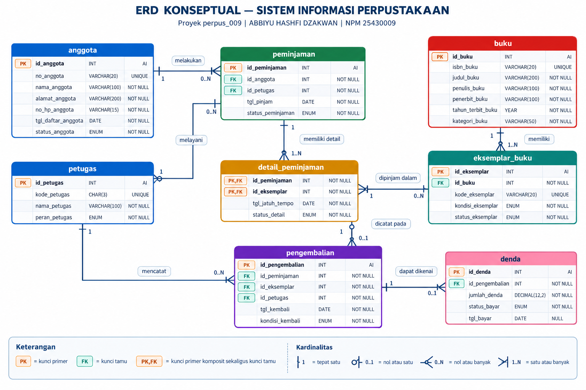
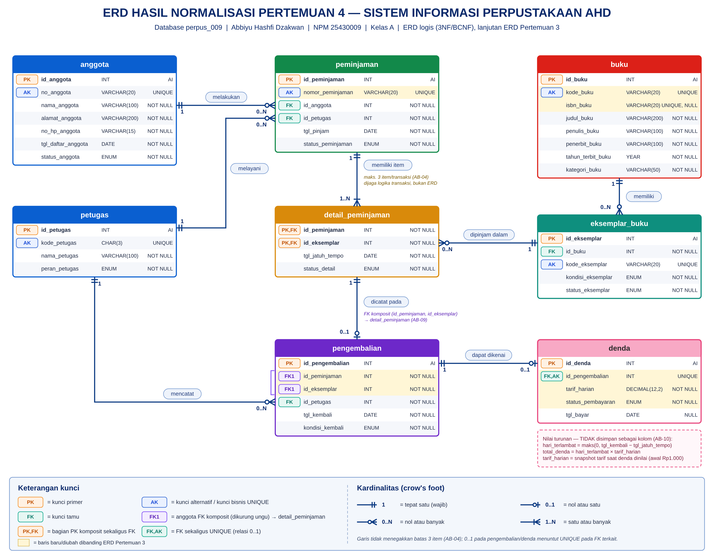
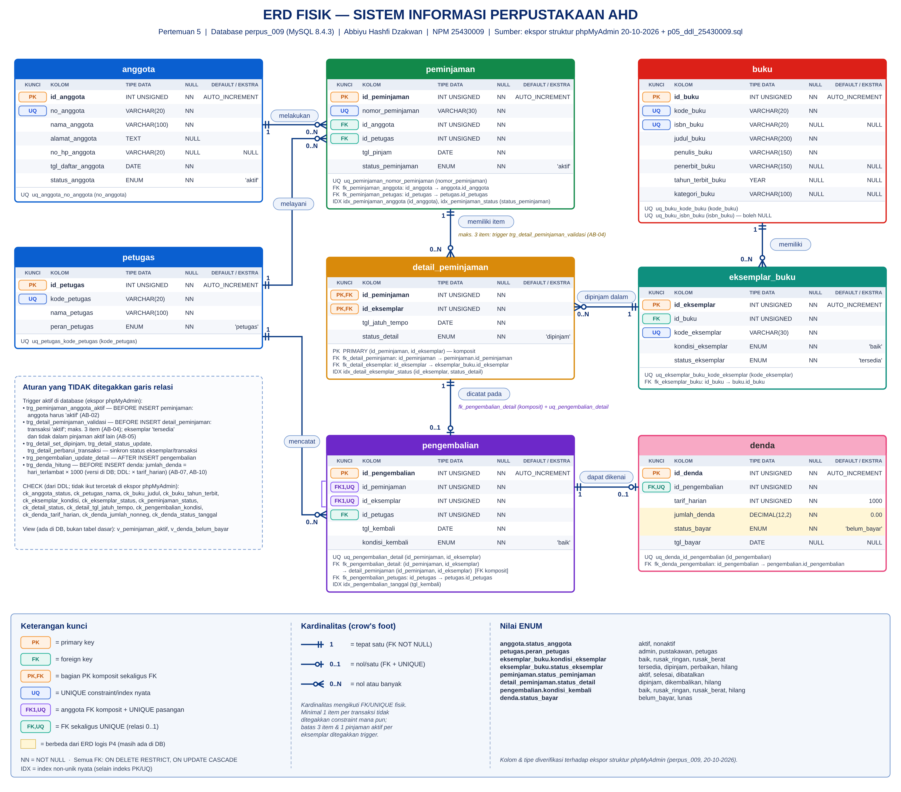

# Praktikum Basis Data

## Identitas Mahasiswa

- **Nama:** Abbiyu Hashfi Dzakwan
- **NPM:** `25430009`
- **Kelas:** `A`

## Deskripsi Proyek

Proyek ini merupakan proyek praktikum Basis Data yang dikerjakan secara individu dan dikembangkan secara bertahap dari Pertemuan 1 sampai Pertemuan 16.

Proyek menggunakan tema **Sistem Informasi Perpustakaan AHD** dengan nama basis data `perpus_009`. Pengembangan proyek mencakup analisis kebutuhan data, pemodelan ERD, normalisasi, implementasi struktur basis data, pengujian constraint, pembuatan kueri, serta dokumentasi praktikum.

## Struktur Proyek

Struktur berikut disesuaikan dengan berkas yang ada di repositori saat ini.

```text
basisdata-25430009/
├── README.md
├── p01_lingkungan_25430009.sql
├── p02_kebutuhan_data_25430009.md
├── p03_erd_25430009.drawio
├── p04_erd_25430009.drawio
├── p04_normalisasi_25430009.md
├── p05_ddl_25430009.sql
├── p05_erd_fisik_25430009.drawio
├── Laporan/
│   ├── p01_laporan_25430009.md
│   ├── p02_laporan_25430009.md
│   ├── p03_laporan_25430009.md
│   ├── p04_laporan_25430009.md
│   └── p05_laporan_25430009.md
└── Screenshots/
    ├── p03_erd_25430009.png
    ├── p04_erd_25430009.png
    ├── p05_erd_fisik_25430009.png
    ├── Screenshot_20261002_083752.png
    ├── Screenshot_20261002_083828.png
    ├── Screenshot_20261002_103733.png
    ├── Screenshot_20261002_104056.png
    ├── Screenshot_20261002_105046.png
    ├── Screenshot_20261002_105409.png
    ├── Screenshot_20261002_105501.png
    ├── Screenshot_20261002_111329.png
    ├── Screenshot_20261002_111450.png
    ├── Screenshot_20261002_111742.png
    ├── Screenshot_20261002_111833.png
    ├── Screenshot_20261002_111911.png
    ├── ss_p05_01_hasil_import.jpg
    ├── ss_p05_02_show_create_table.jpg
    ├── ss_p05_03_uji_fk.jpg
    ├── ss_p05_04_uji_unique.jpg
    └── ss_p05_05_uji_check.jpg
```

## Daftar Pekerjaan Praktikum

| Pertemuan | Kegiatan | Berkas utama |
|---|---|---|
| 1 | Persiapan lingkungan basis data | `p01_lingkungan_25430009.sql`, `Laporan/p01_laporan_25430009.md` |
| 2 | Analisis kebutuhan data dan aturan bisnis | `p02_kebutuhan_data_25430009.md`, `Laporan/p02_laporan_25430009.md` |
| 3 | Pemodelan ERD konseptual | `p03_erd_25430009.drawio`, `Screenshots/p03_erd_25430009.png`, `Laporan/p03_laporan_25430009.md` |
| 4 | Normalisasi UNF–3NF, dependensi fungsional, pemeriksaan BCNF, dan nilai turunan | `p04_normalisasi_25430009.md`, `p04_erd_25430009.drawio`, `Screenshots/p04_erd_25430009.png`, `Laporan/p04_laporan_25430009.md` |
| 5 | Implementasi DDL, constraint, pengujian, dan ERD fisik | `p05_ddl_25430009.sql`, `p05_erd_fisik_25430009.drawio`, `Screenshots/p05_erd_fisik_25430009.png`, `Laporan/p05_laporan_25430009.md` |
| 6–16 | Pengembangan lanjutan sesuai modul praktikum | Akan ditambahkan sesuai tahapan pengerjaan |

## ERD Pertemuan 3 — Konseptual

ERD konseptual menggambarkan entitas, atribut, kunci, relasi, dan kardinalitas pada Sistem Informasi Perpustakaan berdasarkan analisis kebutuhan awal.



- **Sumber diagram yang dapat diedit:** [`p03_erd_25430009.drawio`](p03_erd_25430009.drawio)
- **Laporan:** [`Laporan/p03_laporan_25430009.md`](Laporan/p03_laporan_25430009.md)

## ERD Pertemuan 4 — Hasil Normalisasi

Diagram ini menampilkan rancangan relasi hasil normalisasi yang digunakan sebagai dasar penyesuaian sebelum implementasi DDL.



- **Sumber diagram yang dapat diedit:** [`p04_erd_25430009.drawio`](p04_erd_25430009.drawio)
- **Dokumen normalisasi:** [`p04_normalisasi_25430009.md`](p04_normalisasi_25430009.md)
- **Laporan:** [`Laporan/p04_laporan_25430009.md`](Laporan/p04_laporan_25430009.md)

## ERD Pertemuan 5 — Fisik

ERD fisik menggambarkan implementasi struktur basis data Perpustakaan AHD. Diagram perlu sesuai dengan struktur yang benar-benar diterapkan di database `perpus_009`, termasuk tabel, kolom, primary key, foreign key, dan constraint unik yang relevan.



- **Sumber diagram yang dapat diedit:** [`p05_erd_fisik_25430009.drawio`](p05_erd_fisik_25430009.drawio)
- **Skrip DDL:** [`p05_ddl_25430009.sql`](p05_ddl_25430009.sql)
- **Laporan:** [`Laporan/p05_laporan_25430009.md`](Laporan/p05_laporan_25430009.md)

## Dokumentasi dan Bukti Praktikum

Laporan praktikum disimpan pada folder `Laporan/`. Gambar ERD dan tangkapan layar bukti pelaksanaan disimpan pada folder `Screenshots/`. Nama file pada tautan Markdown harus sama persis dengan nama file di repositori agar gambar dapat terlihat pada VS Code Preview dan GitHub.

Bukti pengujian Pertemuan 5 meliputi hasil implementasi, tampilan `SHOW CREATE TABLE`, pengujian foreign key, pengujian UNIQUE, dan pengujian CHECK. Tangkapan layar yang digunakan pada laporan sebaiknya berasal dari eksekusi sebenarnya.

## Teknologi dan Perangkat

- **DBMS:** MariaDB/MySQL sesuai lingkungan praktikum.
- **Pemodelan ERD:** Draw.io (diagrams.net).
- **Dokumentasi:** Markdown.
- **Kontrol versi:** Git dan GitHub.

## Status Proyek

Dokumentasi dan berkas utama untuk Pertemuan 1–5 telah tersedia. Pengembangan berikutnya akan dilanjutkan sesuai modul Pertemuan 6–16, lalu diperbarui seiring penyelesaian setiap pertemuan.
